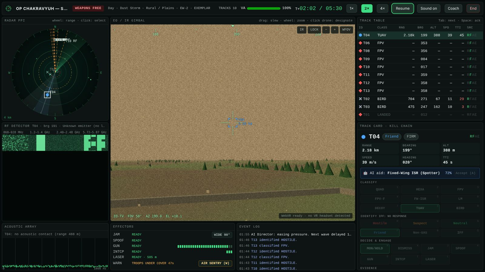
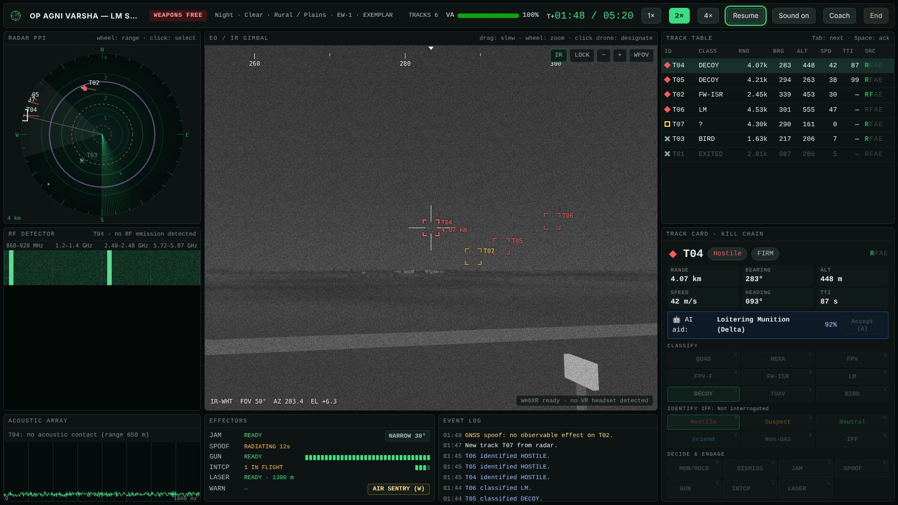
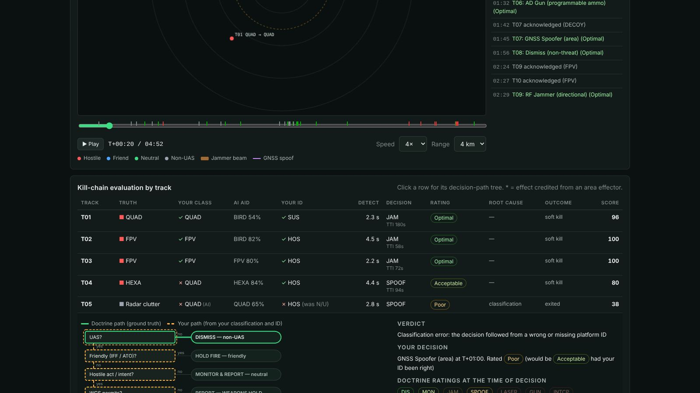
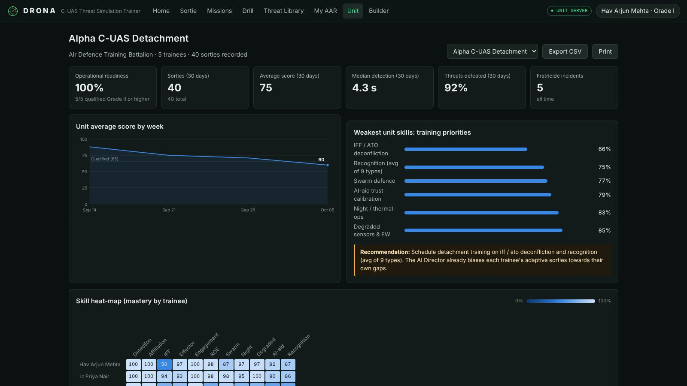
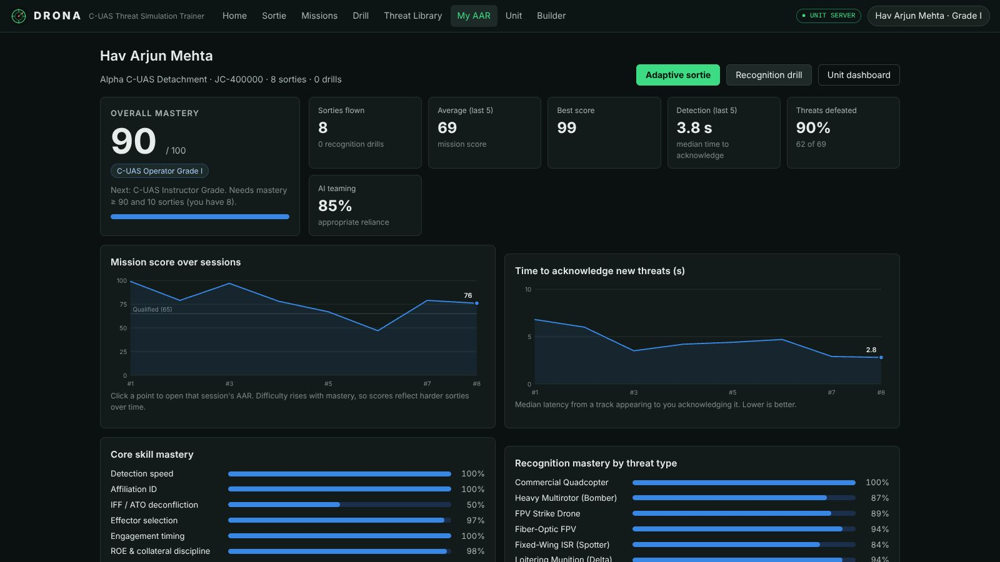
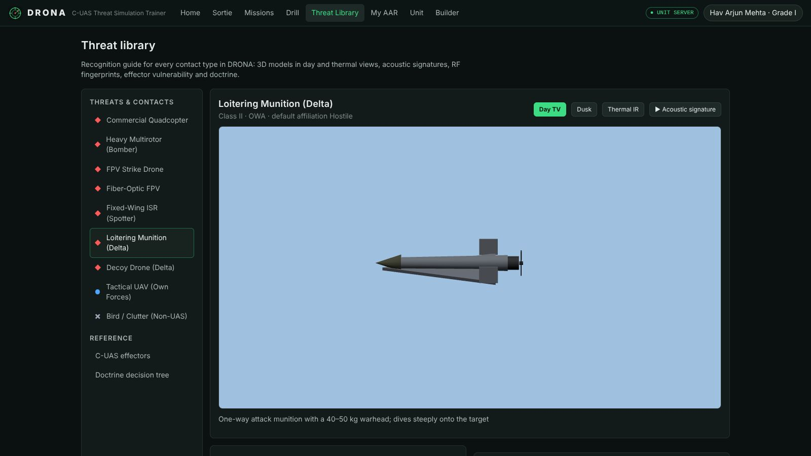

# DRONA: AI-Enabled Drone & Counter-Drone Threat Simulation Trainer

**D**rone **R**ecognition, **O**bservation & **N**eutralisation **A**cademy. Smart India Hackathon, **PS 26247**
(Ministry of Defence · Defence Services Staff College · Robotics and Drones).

DRONA is a software C-UAS operator trainer that runs on any unit laptop in a browser, needs no internet,
and can be used in VR. Trainees detect, track, identify and defeat single drones and swarms by day and night, in urban,
rural and mountain terrain, with degraded sensors. Every decision is scored against a **doctrinal decision tree**, and
every session goes into an **after-action review (AAR)** that tracks individuals and the whole unit over time.

```
npm start                 # → http://localhost:8080 (share the LAN URL with trainees)
npm run seed-demo         # optional: load a demo detachment with 64 recorded sorties
npm test                  # 36 automated tests (engine, doctrine, scoring, AI, server)
```

Requirements: Node.js ≥ 18 and nothing else. There are zero npm dependencies; Three.js is vendored for offline use. Any
WebGL browser works (Chrome, Edge, Firefox). A WebXR headset is optional.

---

| Operator console: swarm assault, dust, EW | Night thermal: loitering munitions and decoys |
| --- | --- |
|  |  |
| **AAR: decision-path tree (your path vs doctrine)** | **Unit dashboard: readiness and skill heat-map** |
|  |  |
| **Trainee progress: mastery, trends, confusion matrix** | **Threat library and scenario builder** |
|  |  |

A 5-minute demo script for judges is in [docs/DEMO.md](docs/DEMO.md).

## How it meets the problem statement

| Expected outcome | DRONA |
| --- | --- |
| Desktop or VR-capable simulator with scripted and procedurally generated threat scenarios | 3D C-UAS operator console (Three.js) with radar PPI, RF spectrum waterfall, acoustic array, EO/IR gimbal (TV and thermal) and effector control. **WebXR** observation post with controller designation and an in-VR action panel. **8 scripted missions**, a **seeded procedural generator** and an **instructor scenario builder**. |
| Decision-tree scoring on detection time, classification accuracy and engagement decisions | Every track is scored along the kill chain: detection latency, classification (with partial credit), identification, decision quality from the **C-UAS doctrine tree**, timeliness and outcome. Penalties apply for fratricide, collateral damage, ROE breaches, own-UAV EW hits and wasted effectors. |
| AAR dashboard tracking individual and unit performance over repeated sessions | Session AAR with **tactical replay** and timeline scrubber, **decision-path tree** (your path against the doctrine path), and **AI coach** debrief. Trainee page with mastery, trends, **confusion matrix**, root causes and qualification ladder. **Unit dashboard** with readiness, weekly trend, skill heat-map, roster and CSV export. |
| Adjustable difficulty and scenario randomisation to prevent rote learning | 4 tiers (Recruit to Elite) plus **Adaptive**: the AI Director picks the tier and aims the scenario at each trainee's weakest skills. Scenarios use forked seeded RNG. **Fingerprint de-duplication** means a trainee never flies the same sortie twice. Scripted missions are jittered on every run. A **live director** injects pop-up threats or eases pressure. |
| Day/night, degraded sensors, urban/rural, single and swarm attacks | 3 terrains × 3 light conditions × 4 weather states × 3 EW levels, with radar terrain masking, clutter, birds, RF noise and IFF failures. Swarms use boids with saturation, wedge, split and decoy-screen tactics, and react to jamming by switching elements to autonomous mode. |
| Usable at unit level with minimal specialised hardware | One laptop runs the zero-dependency server and trainees connect over the LAN. The app also works fully offline on a single device (local storage) and installs as a PWA. |

## What makes it different

1. **Root-cause scoring (dual-path decision tree).** Each decision is evaluated twice: on ground truth and on *what the
   trainee reported*. If you jam a fiber-optic FPV that you classified as a normal FPV, the AAR reports a
   **classification** error, not a doctrine error, because jamming *was* correct for the FPV you thought it was. Other
   root causes are identification, doctrine, situation, timing, no decision and undetected.
2. **Human–AI teaming training.** An ATR "AI decision aid" proposes a classification with a confidence. It gets less
   reliable at night, in fog and under EW, and decoys can fool it. Trainees are scored on *appropriate reliance*:
   accepting a wrong suggestion is flagged, and correctly overriding one is rewarded.
3. **Adaptive Red-Force AI Director.** Bayesian Knowledge Tracing over **19 skills** (detection, ID, IFF, effector
   choice, timing, ROE, swarm, night, EW, AI teaming, and recognition of each of 9 contact types) drives the next
   sortie's tier, terrain, time, EW, threat mix and friendly traffic.
4. **Realistic current threats.** Commercial quad, heavy hexacopter bomber, FPV, **fiber-optic FPV (cannot be jammed)**,
   fixed-wing artillery spotter, Shahed-class loitering munition, Gerbera-class **decoy**, own-force tactical UAV (IFF
   and ATO deconfliction), and birds and radar clutter.
5. **Effector trade-offs.** Directional RF jammer (narrow or wide beam), GNSS spoofer, AD gun, interceptor drone and
   laser DEW. Each has its own range, Pk model, dwell or activation time, ammunition, weather sensitivity, collateral risk
   and **EW fratricide** (jamming or spoofing your own UAV).
6. **Exemplar operator.** A doctrine-driven AI flies any scenario so trainees can watch a model run. The test suite and
   the builder's headless validator use the same bot to check calibration.
7. **Recognition drill.** Flash-ID of zoomed EO/IR images (day, dusk, thermal, haze) with acoustic and RF cues and
   adaptive sampling of the types a trainee confuses. It gives hundreds of repetitions in minutes.
8. **Offline and auditable.** No cloud services. The coach is rule-based natural-language generation, so every sentence
   traces back to a scored event.

## Using DRONA

* **Home** → *Adaptive sortie* (the AI Director chooses), *Custom sortie* (pick conditions and seed), *Scripted missions*,
  *Recognition drill*, *Watch the exemplar*, *Threat library*, *My AAR*, *Unit dashboard* and *Scenario builder*.
* **Console** (keyboard-first, like a real C-UAS cell):

| Key | Action | Key | Action |
| --- | --- | --- | --- |
| Tab / Space | next track / acknowledge | 1–9 | classify platform |
| H U N F B | hostile / suspect / neutral / friend / non-UAS | Q | IFF interrogate |
| A | accept the AI suggestion | M / X | monitor (hold fire) / dismiss |
| J / R | RF jam / toggle narrow–wide beam | K | GNSS spoof |
| G / I / L | gun / interceptor / laser | W | air-sentry warning (troops take cover) |
| V | TV ↔ thermal IR | E | EO lock on the selected track |
| [ ] / arrows / drag | zoom / slew | P | pause |

  Click a drone in the EO view to designate it visually, even before the radar has a track. Turn on *Coach* to see the
  doctrinal recommendation for what you have reported (training wheels for recruits).

* **VR:** with a WebXR headset an *Enter VR* button appears in the EO pane. Point at a drone and pull the trigger to
  designate it, then use the floating panel for ID and engagement.

## Architecture

```
public/                      browser app (ES modules, no build step)
  js/core/                   seeded RNG, maths, DOM helpers, storage (server ↔ offline), CSV
  js/sim/                    pure simulation: catalog, terrain, scenario generator & missions, engine
  js/ai/                     doctrine tree, scoring, coach, mastery (BKT), director, ATR aid, exemplar & trainee bots
  js/render/                 Three.js world (thermal, weather, WebXR), models, PPI, RF waterfall, audio, turntable
  js/ui/                     console, setup, AAR, trainee, unit, drill, library, builder, charts, tree view
  vendor/three/              three.js r170 (MIT), vendored for air-gapped use
server/                      zero-dependency Node HTTP server + JSON datastore (atomic writes)
scripts/                     seed-demo (realistic unit history), headless-run (calibration table)
tests/                       node:test suites
docs/PLAN.md                 solution plan, doctrine tree, AI components, roadmap
```

* The **sim core and AI layer have no DOM**. They run in Node for tests, seeding and the exemplar, and in the browser for
  training.
* **Deterministic**: a fixed 20 Hz step and forked seeded RNG streams, so the same seed and the same commands give the
  same sortie.
* **REST API** (`/api`): `units`, `trainees`, `sessions` (summary index + full record with replay), `scenarios`,
  `export/sessions.csv`, `health`. Data lives in `./data` (override with `DRONA_DATA`; port with `PORT`). Run
  `seed-demo` while the server is stopped.

## Calibration

`npm run headless` plays every mission with the doctrinal exemplar and with an idle operator:

| Scenario set | Exemplar (doctrine) | Idle operator |
| --- | --- | --- |
| 7 scripted missions, Recruit to Veteran | 98–100 | 0–15 |
| OP CHAKRAVYUH (Elite swarm) | 79 | 0 |
| Procedural sorties: Recruit / Operator / Veteran / Elite | 100 / 99 / 82 / 74 | ≤ 4 |

Elite is designed to exceed a single C-UAS cell's capacity, so even perfect doctrine leaks some drones. That is the
point of the saturation lesson.

## Roadmap

Multi-operator crew mode (sensor operator, fire controller and commander), DEM/GIS import of real training areas, an
imagery-based ATR model (ONNX in the browser), a hardware-in-the-loop console bridge, Electron/Tauri packaging, and SSO
with role-based access. See [docs/PLAN.md](docs/PLAN.md).

*All threat and effector parameters are generic, open-source-representative values for training only.*
